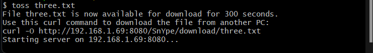

# Toss

  <div align="center">
    
</div>

**Toss** is a lightweight command-line tool designed to simplify file sharing over a local network. With Toss, you can quickly make files available for download from any device on the same network for a specified duration.

## Features

- **Instant Sharing**: Easily share files with others using a simple command.
- **Time-Limited Access**: Control how long the shared file remains accessible.
- **Folders**: Share a whole folder; Toss zips it for you after asking.
- **Pull**: Download from another Toss with `toss pull <link>`, with progress and resume.
- **User-Friendly**: Minimal setup and straightforward usage.

## Installation

You can install Toss with the following command:

```
curl -o- https://raw.githubusercontent.com/snyype/toss/main/install.sh | bash
```

# Usage
Run the command with the desired file and an optional duration:

<div>
    
</div>

```
toss -t 300 myfile.txt      # share for 300 seconds (5 minutes)
toss myfile.txt -t 60       # flags can also go after the file
toss -p 9000 myfile.txt     # use a different port (a free one is picked if busy)
toss myfolder               # share a folder: asks, then zips it as myfolder.zip
toss -y myfolder            # zip and share without asking
```

When you share a folder, Toss zips it into a `temp` folder inside the Toss install directory (e.g. `C:\toss\temp` or `~/.local/bin/temp`) and deletes the zip when Toss exits. If Toss is killed before it can clean up, the next run removes the leftover. Your original folder is never modified.

Toss prints a download link. On another device that has Toss, copy the green line:
```
toss pull http://<your-ip>:8080/<hostname>/download/myfile.txt     # `toss stream <link>` does the same
```
The file is saved to a `downloads` folder inside the Toss install directory (e.g. `C:\toss\downloads`), and the full path is printed when it finishes. If a file with that name is already there, the new one is saved as `myfile (1).txt`. If the download is interrupted (or you press Ctrl+C), run the same command again to resume.

Without Toss on the other device:
```
curl -o myfile.txt http://<your-ip>:8080/<hostname>/download/myfile.txt
curl -C - -o myfile.txt http://<your-ip>:8080/<hostname>/download/myfile.txt   # resume an interrupted download
```
Or just open the link in a browser. Files are streamed from disk, so large files work without using extra memory, and downloads already in progress are allowed to finish when the link expires.

If the printed address is not reachable (VPN, multiple network adapters), Toss also lists your other addresses to try. On Windows, allow `toss.exe` through the firewall when prompted.

While sharing, Toss shows a live view refreshed every 3 seconds: each client's IP and machine name, the app downloading (curl, Chrome, ...), progress, current speed, elapsed time and ETA, plus total speed and open connections. Use `-q` to hide it. Large files (several GB) are fine.

# Logs
Every share and download is recorded in a `logs` folder inside the Toss install directory (e.g. `C:\toss\logs` or `~/.local/bin/logs`).

```
toss logs            # show the 20 most recent entries
toss logs -n 50      # show more
toss logs -path      # print the log file location
toss logs -clear     # delete the history
```

# Updating
```
toss update          # check GitHub for a newer release and ask before installing
toss update -check   # only check, don't install
toss update -y       # install without asking
```
The new version is downloaded, checked to make sure it runs, and only then swapped in, so a failed download leaves your current install untouched.

# Releasing
Releases and the website are automated by `.github/workflows/release.yml`. On every merge to `main`:

1. The code is checked (gofmt, `go vet` for Linux, macOS and Windows).
2. `docs/` is deployed to GitHub Pages.
3. If the `version` in `main.go` has no release yet, binaries are built for Windows, Linux and macOS (amd64 + arm64), the Windows icon/version info is regenerated, and `win-<version>`, `linux-<version>` and `darwin-<version>` releases are published with notes from the commit messages.

So to ship a new version: bump `var version = "x.y.z"` in `main.go` and merge to `main`. `toss update` and `install.sh` pick it up automatically.

One-time setup: in the repo go to **Settings → Pages** and set **Source** to **GitHub Actions**.

# Building locally
```
go build -o toss .            # Linux / macOS
go build -o toss.exe .        # Windows (icon and version info come from the rsrc_windows_*.syso files)
```

# License
This project is licensed under the MIT License. See the LICENSE file for details.

# Contribution
Contributions are welcome! Feel free to open issues or submit pull requests.

# Contact
For questions, please open an issue on the GitHub repository.
